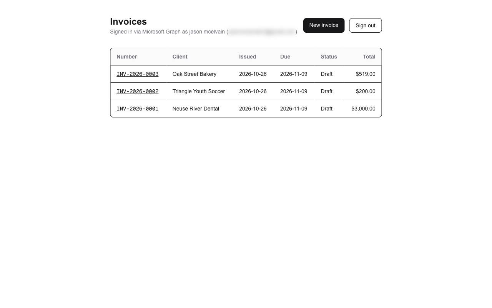

# MacPlusSupport Office

Invoices, payments and reminders for small businesses: a portfolio project by [Jason McElvain](https://jasonmcelvain.netlify.app), built in public one weekend at a time.

**Live demo:** https://YOUR-PROJECT.vercel.app (sign in with any Microsoft account; you get a private sandbox business with fictional clients)



## What it does

| Weekend | Feature | Status |
| --- | --- | --- |
| 1 | Microsoft sign-in (Entra ID, MSAL, PKCE), per-user demo business, race-safe invoice numbers | ✅ |
| 2 | PDF invoices, searchable history, send through Outlook with Microsoft Graph | ⏳ |
| 3 | Stripe "Pay this invoice", webhooks, care-plan subscriptions | ⏳ |
| 4 | Twilio SMS / WhatsApp reminders with delivery status | ⏳ |
| 5 | AI assistant that answers only from the business's own documents | ⏳ |
| 6 | Hardening: rate limits, tests in CI, demo reset | ⏳ |
| 7 | Google Wallet membership pass | ⏳ |
| 8 | Shopify app on a dev store | ⏳ |

## Invoice numbers that can't collide

Invoice numbers look like `INV-2026-0042`, restart each year, and must never repeat or skip, even when two people save at the same moment.

The common approach, `select max(seq) + 1`, fails under load: two requests read the same max and both try to use it. This repo includes a test that fires 50 invoice creations at once:

```
$ npm run test:race -- 50 --naive
50 concurrent creates (NAIVE max+1)
  succeeded:  6
  failed:     44     ← duplicate key errors

$ npm run test:race -- 300
300 concurrent creates (locked counter) in 779 ms
  succeeded:  300
  duplicates: 0
  gaps:       0
PASS: every number used exactly once
```

The fix is one statement ([src/lib/invoices.ts](src/lib/invoices.ts)): an upsert on a per-business, per-year counter row, run in the same transaction as the invoice insert. Postgres locks that row until the transaction commits, so requests take turns, and a failed insert rolls the counter back, so there are no gaps. A `unique (business_id, number)` constraint backs it up.

## Microsoft sign-in

- Authorization code flow with PKCE through `@azure/msal-node` (no wrapper library), plus a `state` check against CSRF.
- Delegated permissions only: the app acts as the signed-in user and never gets tenant-wide access. Weekend 1 asks only for `User.Read`; `Mail.Send` is requested later through incremental consent, the first time a user sends an invoice.
- Works with work/school accounts and personal Microsoft accounts (`/common` authority).
- MSAL's token cache is stored in Postgres per browser session and **encrypted with AES-256-GCM** before it's written, because it contains refresh tokens.
- Every query is scoped by the `business_id` in the signed session cookie, never by an id from a form or URL. Another business's invoice id returns a plain 404.

## Tech

Next.js 16 (App Router, server actions) · TypeScript · Postgres on Neon · `pg` · `@azure/msal-node` · `iron-session` · `zod` · Tailwind · Vercel

## Run it locally

Prerequisites: Node 20.6+, a free [Neon](https://neon.tech) database, and a Microsoft Entra app registration (steps below).

```bash
git clone https://github.com/MacSupportPlus/macplussupport-office.git
cd macplussupport-office
npm install
cp .env.example .env.local      # then fill in the values
npm run db:migrate
npm run test:race               # optional: prove the numbering
npm run dev                     # http://localhost:3000
```

### Microsoft Entra app registration

1. [entra.microsoft.com](https://entra.microsoft.com) → **App registrations** → **New registration**.
2. Supported account types: **Accounts in any organizational directory and personal Microsoft accounts**.
3. Redirect URI: platform **Web**, `http://localhost:3000/api/auth/callback`. Add your Vercel URL + `/api/auth/callback` later.
4. **Certificates & secrets** → new client secret → copy the **Value** into `AZURE_CLIENT_SECRET`.
5. **API permissions**: Microsoft Graph → Delegated → `User.Read` (already there by default). No admin consent needed.

## Security notes

- Secrets live only in environment variables. `.env.local` is git-ignored; `.env.example` documents every variable.
- All data is fictional and created per signed-in user. No real customer data.
- Money is stored as integer cents.

## License

MIT
